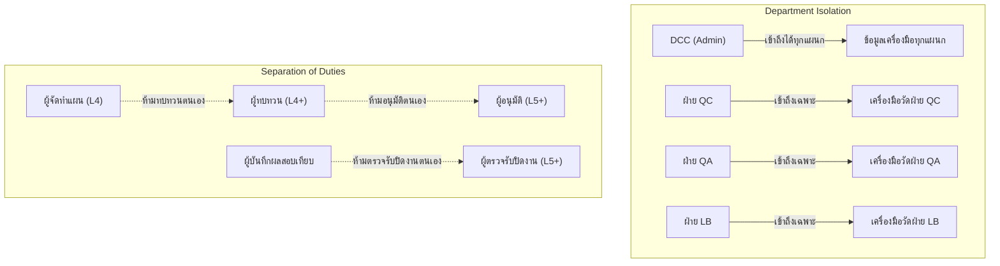

# แผนการเตรียมความพร้อมสำหรับการตรวจรับมอบระบบและการตรวจประเมิน (VCC UAT & Audit Readiness Plan)

> **สถานะโครงการ**: พัฒนาระบบ VCC UX/UI และฟังก์ชันการทำงานหลักเสร็จสมบูรณ์ โค้ดทั้งหมดผ่านระบบตรวจอัตโนมัติบนสาขาหลัก (`develop`) เรียบร้อยแล้ว  
> **ขอบเขตมาตรฐานที่อ้างอิง**:  
> - ISO 9001:2015 (ข้อ 7.1.5 ทรัพยากรในการเฝ้าติดตามและการวัด และข้อ 7.5 ข้อมูลเอกสาร)  
> - ISO/IEC 17025:2017 (ข้อ 6.4 เครื่องมือวัดและอุปกรณ์, ข้อ 7.8 การรายงานผลการสอบเทียบ และข้อ 7.8.8 การแก้ไขรายงานผล)  
> **ข้อกำหนดความปลอดภัยสูงสุด**: ห้ามส่งขึ้นระบบจริง (Production) และห้ามแตะต้องฐานข้อมูลจริงเด็ดขาด จนกว่าจะผ่านการตรวจรับครบทุกเกณฑ์

---

## 1. วัตถุประสงค์และขอบเขตการตรวจรับ (Objectives & Scope)

1. **วัตถุประสงค์**:
   - เพื่อให้ผู้ใช้งานจริง (เจ้าหน้าที่ควบคุมเอกสาร DCC, ผู้จัดการฝ่ายควบคุมคุณภาพ QC, ฝ่ายประกันคุณภาพ QA, และ QMR) ได้ทดสอบกระบวนการทำงานจริงตามขั้นตอนการปฏิบัติงาน (SOP)
   - เพื่อตรวจยืนยันความถูกต้อง ความปลอดภัยของข้อมูล และการแยกหน้าที่ (Separation of Duties) ก่อนการพิจารณาส่งมอบระบบ
   - เพื่อเตรียมความพร้อมของหลักฐานดิจิทัล (Audit Evidence) ตามข้อกำหนด ISO 9001:2015 และ ISO/IEC 17025:2017
2. **ขอบเขตระบบ VCC**:
   - การขึ้นทะเบียนเครื่องมือวัด (Asset Register) ทั้งแบบเดี่ยว (Individual Asset) และชุดรวม (Composite Set)
   - การจัดทำแผนทวนสอบและสอบเทียบประจำปี (Annual Planning Matrix) และการอนุมัติแบบดิจิทัล
   - การออกใบสั่งงาน (Work Orders) ทั้งในแผนประจำปีและกรณีเร่งด่วนนอกแผน (Ad-hoc)
   - การบันทึกผลการสอบเทียบ (PASS / FAIL), ความคลาดเคลื่อน (Error), ความไม่แน่นอน (Uncertainty) และการแนบไฟล์ใบรับรอง PDF
   - การตรวจรับและปิดใบสั่งงาน พร้อมกลไกควบคุมสถานะเครื่องมือวัด (Auto Status: ACTIVE vs ON_HOLD)
   - การขอแก้ไขผลอย่างควบคุม (Controlled Amendment Trail)
   - การประเมินผลกระทบต่อผลิตภัณฑ์และการขออนุมัติปลดระงับเครื่องมือ (Release Hold)
   - การใช้งานผ่านอุปกรณ์พกพา (Mobile & Tablet Ergonomics) และการพิมพ์เอกสารดิจิทัลแบบหลายหน้า

---

## 2. การควบคุมความปลอดภัยและสิทธิ์การเข้าถึง (Role & Permission Policy)

การควบคุมสิทธิ์ในระบบ VCC อ้างอิงตามโค้ดและกลไกความปลอดภัยที่พัฒนาจริงในระบบหลังบ้าน (`vccAuth.js`, `vccPlans.js`, `vccWorkOrders.js`):

### 2.1 แผนกที่ได้รับอนุญาต (Authorized Departments)
เฉพาะผู้ใช้ที่สังกัดแผนกต่อไปนี้เท่านั้นที่มีสิทธิ์เข้าใช้งานโมดูล VCC:
- **DC (Document Control Center / DCC)**
- **QC (Quality Control)**
- **QA (Quality Assurance)**
- **MGT (Management / QMR)**
- **LB (Laboratory)**  
*(ผู้ใช้จากแผนกอื่น เช่น HR, AC, PU, WH, EN, RD จะไม่สามารถเข้าถึงข้อมูลของ VCC ได้ โดยระบบ API จะส่งคืนข้อผิดพลาด HTTP 403 Forbidden ทันที)*

### 2.2 การแบ่งแยกหน้าที่และการป้องกันการอนุมัติตนเอง (Separation of Duties & Self-Approval Prevention)
1. **การจัดทำและอนุมัติแผนประจำปี (Annual Plan)**:
   - ผู้จัดทำแผน (Preparer) ต้องมีระดับสิทธิ์ตั้งแต่ L4 ขึ้นไป
   - ผู้ทบทวนแผน (Reviewer) ต้องมีระดับสิทธิ์ L4+ และ **ต้องไม่ใช่บุคคลเดียวกับผู้จัดทำ**
   - ผู้อนุมัติแผน (Approver) ต้องมีระดับสิทธิ์ L5+ (หรือตามเกณฑ์ Approval Matrix) และ **ต้องไม่ใช่บุคคลเดียวกับผู้จัดทำ และต้องไม่ใช่ผู้ทบทวน**
2. **การตรวจรับและปิดใบสั่งงาน (Work Order Review & Approval)**:
   - ผู้บันทึกผลการสอบเทียบ (Performer): เจ้าหน้าที่ผู้ปฏิบัติงานที่ได้รับมอบหมาย
   - ผู้ตรวจรับและอนุมัติปิดใบสั่งงาน (Reviewer): ต้องมีระดับสิทธิ์ตั้งแต่ L5 ขึ้นไป และ **ต้องไม่ใช่บุคคลเดียวกับผู้บันทึกผล (Strictly Prevent Self-Approval)**
3. **การปลดระงับเครื่องมือวัด (Release ON_HOLD)**:
   - สงวนสิทธิ์เฉพาะผู้มีอำนาจระดับ L5 ขึ้นไปที่สังกัดแผนกเจ้าของเครื่องมือ หรือ DCC/QMR เท่านั้น และต้องระบุเหตุผลการประเมินผลกระทบต่อคุณภาพผลิตภัณฑ์ (Impact Assessment)

---

## 3. ตารางเปรียบเทียบสิทธิ์จริง (Implemented Permission Matrix)

| การดำเนินการในระบบ | เจ้าหน้าที่ทั่วไป (L1-L3) | หัวหน้างาน (L4) | ผู้จัดการแผนก (L5) | ผู้อำนวยการ/QMR (L6) | เจ้าหน้าที่ DCC (Admin) |
| :--- | :---: | :---: | :---: | :---: | :---: |
| **ดูรายการเครื่องมือและแผน** | เฉพาะแผนกตนเอง | เฉพาะแผนกตนเอง | เฉพาะแผนกตนเอง | ทุกแผนก | ทุกแผนก |
| **เพิ่ม / แก้ไขข้อมูลเครื่องมือวัด** | ❌ (ไม่มีสิทธิ์) | ✅ (เฉพาะแผนกตน) | ✅ (เฉพาะแผนกตน) | ✅ (เฉพาะแผนกตน) | ✅ (ทุกแผนก) |
| **โอนย้ายเครื่องมือข้ามแผนก** | ❌ | ❌ | ❌ | ❌ | ✅ (DCC เท่านั้น) |
| **จัดทำ / แก้ไขร่างแผนประจำปี** | ❌ | ✅ (เฉพาะแผนกตน) | ✅ (เฉพาะแผนกตน) | ✅ (เฉพาะแผนกตน) | ✅ (ทุกแผนก) |
| **ส่งขออนุมัติแผนประจำปี** | ❌ | ✅ (L4+) | ✅ (L5) | ✅ (L6) | ✅ (DCC) |
| **ทบทวนแผนประจำปี (Review)** | ❌ | ✅ (ที่ไม่ใช่ผู้จัดทำ) | ✅ (ที่ไม่ใช่ผู้จัดทำ) | ✅ (ที่ไม่ใช่ผู้จัดทำ) | ✅ (ที่ไม่ใช่ผู้จัดทำ) |
| **อนุมัติแผนประจำปี (Approve)** | ❌ | ❌ | ✅ (L5+ ที่ไม่ใช่ผู้จัดทำ/ทบทวน) | ✅ (L6 ที่ไม่ใช่ผู้จัดทำ/ทบทวน) | ✅ (L5+ DCC) |
| **เปิดใบสั่งงาน (Create WO)** | ✅ (ที่ได้รับมอบหมาย) | ✅ | ✅ | ✅ | ✅ |
| **บันทึกผลสอบเทียบ (Record)** | ✅ (ผู้ปฏิบัติงาน) | ✅ | ✅ | ✅ | ✅ |
| **ตรวจรับและปิดงาน (Approve WO)** | ❌ | ❌ | ✅ (L5+ ที่ไม่ใช่ผู้บันทึกผล) | ✅ (L6 ที่ไม่ใช่ผู้บันทึกผล) | ✅ (L5+ DCC) |
| **ขอแก้ไขผล (Request Amend)** | ✅ (ระบุเหตุผล) | ✅ | ✅ | ✅ | ✅ |
| **อนุมัติแก้ไขผล (Approve Amend)** | ❌ | ❌ | ✅ (L5+) | ✅ (L6) | ✅ (L5+ DCC) |
| **อนุมัติปลดระงับ (Release Hold)** | ❌ | ❌ | ✅ (L5+) | ✅ (L6) | ✅ (L5+ DCC) |

---

## 4. ความสมบูรณ์ของข้อมูลและบันทึกประวัติ (Data Integrity & Immutability)

1. **Audit Log Protection**:
   - ตาราง `audit_log` มี Database Trigger ป้องกันคำสั่ง `UPDATE` และ `DELETE` อย่างถาวร ทุกความเคลื่อนไหว (สร้าง, ปรับปรุง, เปลี่ยนสถานะ, อนุมัติ) จะถูกเขียนต่อท้าย (Append-Only) เสมอ
2. **Snapshot Immutability**:
   - เมื่อใบสั่งงานถูกปิดแล้ว ข้อมูลผลการสอบเทียบจะถูกล็อกถาวร หากมีการขอแก้ไข (Amendment) ระบบจะสร้างประวัติชุดใหม่พร้อมแนบ Snapshot ข้อมูลเดิมไว้ในระบบประวัติการตรวจสอบย้อนกลับ (Amendment Trail) ตามแนวทาง ISO/IEC 17025 ข้อ 7.8.8
3. **File Integrity via SHA-256**:
   - ไฟล์ใบรับรอง PDF ทุกไฟล์ที่อัปโหลดเข้าสู่ระบบจัดเก็บ R2 Storage จะถูกคำนวณและบันทึกค่า SHA-256 Checksum Hash เสมอ เพื่อเป็นหลักฐานว่าไฟล์ไม่ถูกดัดแปลงภายหลัง

---

## 5. เกณฑ์การตัดสินใจอนุมัติรับมอบระบบ (Go / No-Go Decision Criteria)

ระบบ VCC จะถือว่าผ่านเกณฑ์การทดสอบรับมอบ (Go) และพร้อมสำหรับการพิจารณาขึ้นใช้งานเมื่อ:
1. **Critical/Blocker Defects = 0**: ไม่มีข้อผิดพลาดระดับวิกฤตที่ทำให้ข้อมูลเสียหาย สิทธิ์รั่วไหล หรือขั้นตอนการอนุมัติล้มเหลว
2. **Workflow Test Pass Rate = 100%**: ทุกขั้นตอนทดสอบหลัก (VCC-UAT-001 ถึง VCC-UAT-008) ได้รับการทดสอบและผลลัพธ์ตรงตามที่คาดหวัง
3. **Role & Security Pass Rate = 100%**: การทดสอบปฏิเสธสิทธิ์ (Negative Test) ของผู้ใช้ที่ไม่มีสิทธิ์ทำงานได้อย่างถูกต้อง
4. **Print & Digital Record Completeness**: สามารถดูและพิมพ์เอกสาร Digital Calibration Record ได้ครบถ้วนทุกหน้าโดยไม่มีข้อความตกหล่น
5. **Auditor Sign-off**: ผู้มีอำนาจของฝ่าย DCC และ QC/QA ร่วมลงนามรับรองในเอกสาร [VCC_UAT_Summary_and_Signoff.md](./VCC_UAT_Summary_and_Signoff.md)

